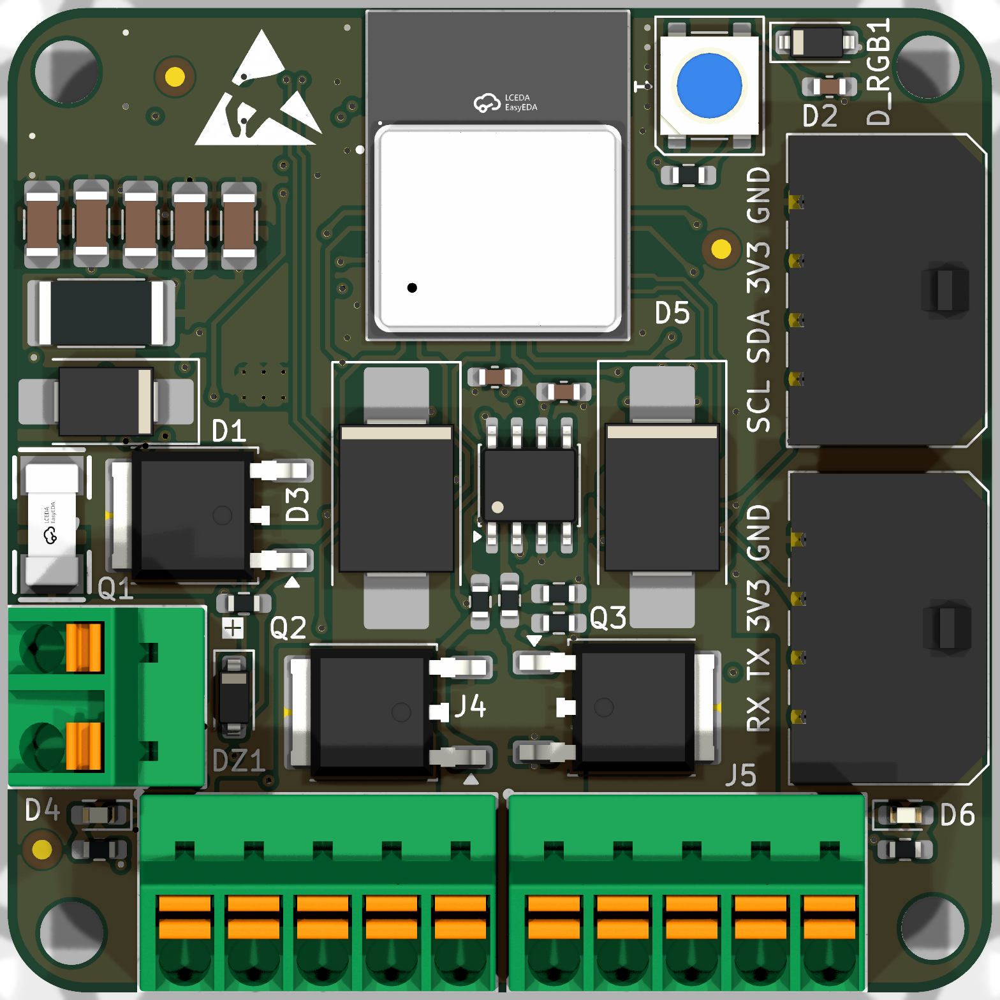
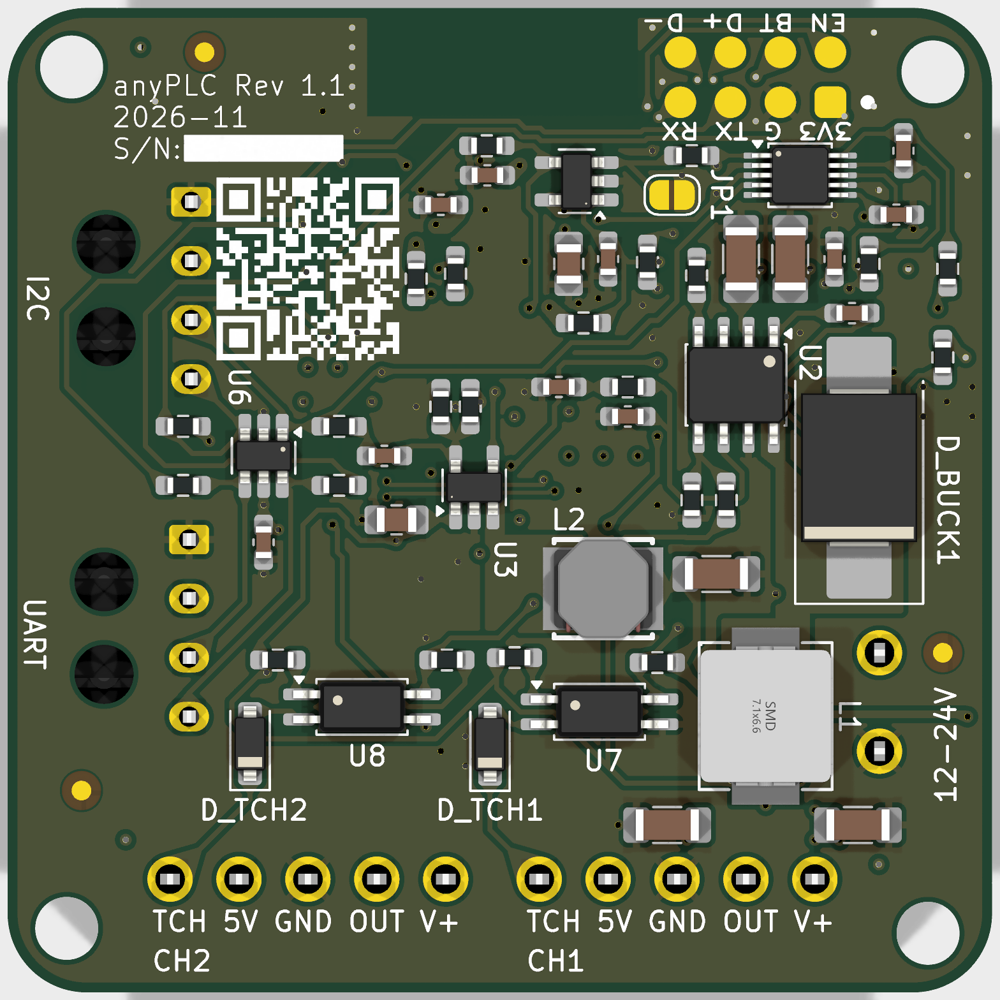

<div align="center">

# anyPLC

**Compact 50 × 50 mm, 4-Layer ESP32-C3 Industrial PWM & Telemetry Controller for ESPHome**

[](#hardware-revisions)
[](https://www.kicad.org/)
[](https://esphome.io/)
[](#license)
[](#license)

<br>



*Raytraced 3D render of the **anyPLC Rev 1.1** front side (50 × 50 mm, 4-layer PCB)*

</div>

---

## Overview

**anyPLC** is a compact, industrial-grade, Wi-Fi/BLE smart controller built around the **ESP32-C3-MINI-1** module and designed for seamless integration with **ESPHome** and **Home Assistant**.

It is engineered for reliable, closed-loop control of **12–24 V DC loads** in tight enclosures, including:
* High-power 12 V / 24 V PWM cooling fans with real-time RPM (tachometer) feedback
* DC water/dosing pumps, solenoids, valves, and inductive actuators (protected by onboard freewheeling diodes)
* High-current DC LED strips or low-voltage resistive heaters
* Autonomous monitoring setups requiring real-time bus voltage/current telemetry and hardware watchdog recovery

<details>
<summary><b>View Front & Back PCB Renders</b></summary>
<br>

| Front Side (`F.Cu`) | Back Side (`B.Cu`) |
| :---: | :---: |
|  |  |

</details>

---

## Hardware Architecture & Specifications

| Subsystem | Components & Specifications |
| :--- | :--- |
| **MCU & Radio** | **ESP32-C3-MINI-1** (`U4`) — 32-bit RISC-V, Wi-Fi 4 + BLE 5, integrated 40 MHz crystal & flash, unobstructed edge antenna keepout |
| **Power Input** | **12–24 V DC** (`J1`), **8 A** input fuse (`F1`), P-channel MOSFET reverse-polarity protection (`Q1`) with ~15 V V<sub>GS</sub> Zener clamp (`DZ1`, `R2`), and **SMBJ26A** TVS surge suppressor (`D1`) |
| **Power Rails** | Dual independent buck stages:<br>• **+5 V Rail (`U2`):** `TPS54360B` (~4.98 V, ~485 kHz, `B560C` catch diode `D_BUCK1`, `L1`)<br>• **+3.3 V Rail (`U3`):** `SY8089` (~3.33 V, fed from +5 V, `L2`) |
| **Power Telemetry** | **INA226** (`U1`) bus voltage & current monitor across a **10 mΩ (2512)** shunt (`R1`) with Kelvin sensing (`R3`/`R4` 10 Ω + `C3`), I2C address **`0x44`**, open-drain `INA_ALERT` pull-up (`R_INA1` 10 kΩ) |
| **Dual PWM Outputs** | 2× low-side N-channel PWM MOSFET stages (`Q2`, `Q3`) driven at +5 V by a dedicated dual gate driver (`U_DRV1`, 10 Ω gate resistors `R13`/`R18`, 10 kΩ pulldowns `R14`/`R19`), **B560C** (60 V / 5 A) freewheeling diodes (`D3`, `D5`), and per-channel active LEDs (`D4`, `D6`) |
| **Tachometer Inputs** | 2× optocoupled open-collector/open-drain tachometer inputs (`U7`, `U8` — `TLP293`), reverse-blocking diodes (`D_TCH1`/`D_TCH2` `1N4148W`), ~1.3 mA LED drive from +5 V, 10 kΩ output pull-ups (`R15`/`R20`) to +3.3 V |
| **Expansion Ports** | Dedicated **I2C** (`J2`, onboard 4.7 kΩ pull-ups `R9`/`R10`) and **UART** (`J3`, 100 Ω series resistors `R11`/`R12`), protected by **SRV05-4** ESD diode array (`U6`) |
| **Hardware Watchdog** | External **STWD100** watchdog timer (`U5`) tied to MCU `EN`, with hardware enable/disable solder jumper (`JP1`, 4.7 kΩ pull-up `R_WD_EN1`) |
| **Status & Debug** | Addressable RGB status LED (`D_RGB1`, WS2812-type) and 2×4 pogo-pad programming/debug interface (`J6`) exposing UART, native USB, `EN`, and `BOOT` |
| **PCB Form Factor** | **50 × 50 mm**, 4-layer stackup (`F.Cu` / `GND` / `Power` / `B.Cu`), 1.6 mm FR-4, teardrops, and dual-sided fiducials for automated PCBA |

---

## Connector Pinouts

### `J1` — Power Input (12–24 V DC)
| Pin | Net | Function |
| :---: | :--- | :--- |
| 1 | `VIN+` | 12–24 V DC input (via `F1` 8 A fuse & `Q1` reverse-polarity MOSFET) |
| 2 | `GND` | System ground |

### `J4` (CH1) & `J5` (CH2) — PWM Output & Tachometer Terminals
| Pin | Net | Function |
| :---: | :--- | :--- |
| 1 | `+V_IN_MAIN` | Protected supply positive (12–24 V DC, load `+`) |
| 2 | `PWM OUT` | Low-side MOSFET Drain (load `-`, flyback diode to Pin 1) |
| 3 | `GND` | System ground |
| 4 | `+5V` | Regulated +5 V auxiliary supply (e.g., for fan electronics / sensors) |
| 5 | `TACHO` | Optocoupled tachometer input (active-low open-collector/open-drain pull-down) |

### `J2` (I2C) & `J3` (UART) — Expansion Ports (**3.3 V Logic Only**)
| Pin | `J2` (I2C) | `J3` (UART) |
| :---: | :--- | :--- |
| 1 | `GND` | `GND` |
| 2 | `+3.3V` | `+3.3V` |
| 3 | `I2C_SDA` (4.7 kΩ pull-up to 3.3 V) | `UART_TX` (via 100 Ω `R11`, ESD protected) |
| 4 | `I2C_SCL` (4.7 kΩ pull-up to 3.3 V) | `UART_RX` (via 100 Ω `R12`, ESD protected) |

### `J6` — Programming & Debug Pogo-Pad (2×4, Bottom Side)
| Pin | Function | Pin | Function |
| :---: | :--- | :---: | :--- |
| 1 | `+3.3V` | 5 | `EN` (Reset) |
| 2 | `GND` | 6 | `BOOT` (`GPIO9`) |
| 3 | `UART_TX` (ESP TXD) | 7 | `USB_D+` |
| 4 | `UART_RX` (ESP RXD) | 8 | `USB_D-` |

### `JP1` — Watchdog Enable Jumper (Bottom Side)
| State | Watchdog (`STWD100`) Behavior |
| :--- | :--- |
| **OPEN** *(default)* | **Disabled** (`R_WD_EN1` pulls enable high). Required during firmware flashing and bench debugging. |
| **CLOSED** *(bridged)* | **Enabled**. Firmware must periodically toggle `WDI` to prevent automatic MCU resets. |

---

## Important Notes, Precautions & Known Limitations

Read these before assembly, flashing, or field deployment:

1. **Keep `JP1` OPEN when flashing:** With `JP1` bridged, the external `STWD100` watchdog receives no `WDI` pulses while the ESP32-C3 is in ROM bootloader mode and will continuously reset the chip. Bridge `JP1` only after flashing firmware that actively feeds `WDI`.
2. **Disconnect `J3` during UART flashing:** `J6` (pogo-pad) and `J3` (UART expansion port) share the same `UART_TX` / `UART_RX` lines (coupled through 100 Ω `R11`/`R12`). Unplug any peripheral on `J3` while flashing through `J6` to avoid bus contention.
3. **`J2` and `J3` are strictly 3.3 V logic:** The `SRV05-4` ESD array (`U6`) clamps I/O pins directly to `+3.3V`. Connecting 5 V I2C or UART logic will forward-bias the clamp diodes above ~4 V and back-feed the 3.3 V rail and ESP32-C3 pins.
4. **INA226 I2C address is `0x44` (not `0x40`):** `U1` has `A1` strapped to `+3.3V` and `A0` to `GND`. Configure `address: 0x44` in ESPHome. Note that `0x44` is also the default I2C address of **SHT3x** temperature/humidity sensors — if connecting an SHT3x to `J2`, strap the sensor's address pin to `0x45` to avoid a bus collision.
5. **No per-port PTC fuses on auxiliary rails:** `+3.3V` (`J2.2`, `J3.2`) and `+5V` (`J4.4`, `J5.4`) connect directly to the internal buck rails. Shorting an external sensor cable will brown out the MCU (`+3.3V`) or put `U2` (`+5V` TPS54360B) into hiccup mode, collapsing both rails.
6. **No external ESD diodes on `J6` USB lines:** `USB_D+` and `USB_D-` run directly from `J6` to `U4`. The pogo-pad header is intended for ESD-safe bench/factory programming rather than exposed field hot-plugging.
7. **24 V hot-plug transient margin:** `SMBJ26A` (`D1`) has a peak clamping voltage up to 42.1 V under rated surge current, while the `INA226` absolute maximum rating is 40 V. Operate within 12–24 V DC nominal and avoid severe unbuffered inductive hot-plug spikes.
8. **First-board bring-up verification:** On initial power-up at 24 V, verify the `+5V` (~4.98 V) and `+3.3V` (~3.33 V) rails before soldering `JP1`, and scope-check the `U2` switch node (`SW`) under load to confirm overshoot stays safely within the `B560C` 60 V rating.

---

## Bring-Up & Flashing Quick Checklist

1. Inspect the assembled board for solder bridges, confirm `JP1` is **open**, and ensure nothing is connected to `J3`.
2. Power the board from a current-limited bench supply (12–24 V DC, ~150 mA limit initially) and verify `+5V` and `+3.3V` rails.
3. Connect your USB/UART programmer to `J6` and flash your ESPHome firmware (include `address: 0x44` in the `ina226:` block).
4. Verify I2C bus discovery (`0x44` for INA226), PWM channel switching (`D4`/`D6`), and tachometer pulse counting.
5. Once your firmware reliably toggles the `WDI` pin, bridge `JP1` to activate the hardware watchdog for deployment.

---

## PCB Manufacturing & DFM

* **Dimensions:** 50.0 × 50.0 mm
* **Layers:** 4 layers (`F.Cu` Signal / `In1.Cu` Solid GND / `In2.Cu` Split Power `+V_IN_MAIN`, `+5V`, `+3.3V` / `B.Cu` Signal)
* **Design Rules:** Verified against JLCPCB 4-layer standard capabilities (min clearance 0.125 mm, min track 0.15 mm, standard vias 0.50 mm / 0.30 mm drill, `U2` thermal pad vias 0.20 mm drill)
* **DFM Features:** Teardrops enabled on pads and vias, 3+3 asymmetric fiducial markers (`F.Cu` and `B.Cu`), tented vias, `JLCJLCJLCJLC` order-number placeholder on `B.Silkscreen`
* **Assembly Note:** If hand-soldering with paste and hot air, request tented/plugged vias or watch solder wicking on the `U2` thermal vias and the central hole of `U4` pad 49.

---

## Repository Structure

```text
anyPLC/
├── anyPLC.kicad_pro          # KiCad 10 project file
├── anyPLC.kicad_sch          # Multi-sheet schematic
├── anyPLC.kicad_pcb          # 4-layer PCB layout
├── docs/
│   └── images/               # Raytraced 3D renders & documentation assets
├── production/               # Gerber, Drill, BOM, CPL, and iBOM outputs
└── README.md
```

---

## Hardware Revisions

* **Rev 1.1** *(Current)* — Initial 4-layer production candidate (`DRC: 0 errors, 0 unconnected`, netlist-audited). Includes teardrops, dual-sided fiducials, repository QR code, ESD markings, and full bottom-side pinout silkscreen.

---

## License

* **Hardware** (schematics, PCB layout, manufacturing files): Licensed under the **CERN Open Hardware Licence Version 2 - Strongly Reciprocal (CERN-OHL-S v2)**.
* **Software & Documentation** (ESPHome configs, scripts, docs): Licensed under the **MIT License**.
